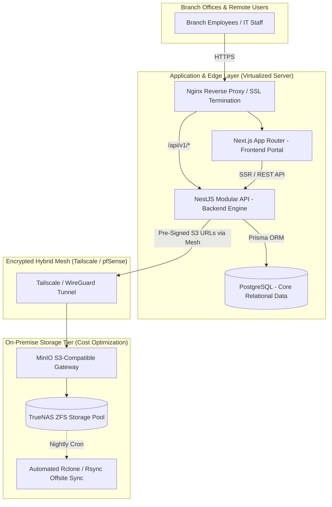

# Enterprise IT Operations Portal & Hybrid Storage Architecture
**Sanitized Architectural Case Study | Full-Stack Engineering & Infrastructure Cost Optimization**

> **Disclaimer:** *This repository documents the architectural design, infrastructure topology, and engineering decisions behind an internal enterprise system deployed across a multi-branch banking institution. To comply with strict banking regulations and Non-Disclosure Agreements (NDAs), proprietary source code, internal IP addresses, and company-specific branding have been sanitized.*

---

## 1. Executive Summary & The Product Realization

In a multi-branch financial institution (10+ branch offices), IT operations were previously fragmented across scattered spreadsheets, chat groups, and a legacy intranet. 

When designing the modern replacement (**IT Hub**), initial assumptions focused heavily on building a complex ticketing engine (SLAs, assignments, queues). However, analyzing actual user behavior from the legacy system revealed a critical product truth: **employees did not visit the portal because they wanted to open tickets; they visited to find operational information, application links, SOPs, forms, and PIC contacts.**

### Strategic Shift & Business Impact
* **Discovery-First Architecture:** Re-architected the platform from a passive "ticket dropbox" into an active **Operational Knowledge & Self-Service Hub**. By surfacing SOPs, quick links, and guided troubleshooting *before* ticket creation, routine support inquiries were deflected at the source.
* **60%+ Cloud Storage Cost Reduction:** Implemented a hybrid cloud-on-premise object storage pipeline. Short-lived, high-volume user uploads (diagnostic screenshots, temporary logs) are routed to on-premise **MinIO / TrueNAS** instances over an encrypted mesh network, preventing cloud storage bloat.
* **Zero-License Overhead:** Replaced potential third-party SaaS costs (Jira Service Management / Confluence per-seat pricing) with a fully self-hosted, banking-compliant stack.

---

## 2. System & Hybrid Storage Architecture

The system operates on a split-horizon hybrid architecture. The core web application remains highly available, while heavy object storage leverages on-premise NAS hardware securely exposed via a private WireGuard/Tailscale mesh tunnel and pfSense routing.



---

## 3. Core Technical Stack

* **Frontend:** Next.js (React, TypeScript, Tailwind CSS) — Optimized for fast internal search, SSR operational dashboards, and low-latency navigation across branch networks.
* **Backend:** NestJS (Node.js, TypeScript) — Strictly modularized into domain services (`KnowledgeBaseModule`, `TicketingModule`, `AssetDirectoryModule`, `StorageModule`).
* **Database & ORM:** PostgreSQL managed via **Prisma ORM** with strict transactional integrity and full-text search indexing.
* **Hybrid Object Storage:** **MinIO** (S3-compatible API) backed by **TrueNAS**, bridged via **Tailscale** and **pfSense**.
* **CI/CD & Deployment:** Docker, Docker Compose, and **GitLab Runner** for automated, zero-downtime container deployments.

---

## 4. Key Engineering Challenges & Solutions

### Challenge 1: High-Volume Ephemeral Uploads Causing Storage Bloat
**Problem:** IT support tickets and operational forms frequently include large video screen recordings, uncompressed logs, and high-res screenshots. Storing all attachments on commercial cloud VPS storage rapidly inflates monthly infrastructure bills, even though 80% of these files become irrelevant 14 days after ticket resolution.
**Solution:** 
* Engineered an S3-compatible **MinIO** storage node sitting on top of on-premise **TrueNAS** hardware.
* Connected the application server to the on-premise storage node using a private **Tailscale** mesh network.
* Implemented automated **S3 Lifecycle Rules** on the bucket to automatically purge or archive temporary ticket attachments after a defined retention period, while keeping permanent SOP documents in a persistent bucket backed up via `rclone`.

### Challenge 2: Deflecting Tickets Through Instant Operational Search
**Problem:** If finding an SOP or form takes more than 10 seconds, branch users abandon self-service and message IT staff directly via WhatsApp or create duplicate tickets.
**Solution:**
* Designed a unified search and directory schema in PostgreSQL using Prisma.
* Prioritized a **"Pekarangan" (Front-Yard) UX Pattern**: The landing view immediately exposes categorized application links, active announcements, downloadable banking forms, and searchable SOPs.
* Integrated contextual deflection inside the ticket creation flow—typing a ticket subject dynamically queries the `KnowledgeArticle` table and suggests immediate step-by-step fixes before the user hits submit.

### Challenge 3: Resolving Local Split-Horizon DNS (Hairpin NAT) Across Branches
**Problem:** Internal branch clients accessing self-hosted web portals via public domain names experienced connection drops or routing loops due to Hairpin NAT limitations on local gateway routers.
**Solution:** Configured local DNS overrides and split-horizon routing across the internal firewall/gateway layer, ensuring internal traffic routes directly to local virtualized reverse proxies (`10.x.x.x` / local host bindings) without looping back through the public WAN interface.

---

## 5. Sanitized Data Model Snippet (`schema.prisma`)

Below is a simplified, sanitized excerpt of the Prisma schema demonstrating how the **Knowledge Hub (Self-Service)** and **Ticketing Engine** are relationally linked to track which SOPs successfully resolve operational issues:

```prisma
datasource db {
  provider = "postgresql"
  url      = env("DATABASE_URL")
}

generator client {
  provider = "prisma-client-js"
}

enum Role {
  BRANCH_USER
  IT_SUPPORT
  IT_SUPERVISOR
  HEAD_OF_IT
}

enum TicketStatus {
  OPEN
  IN_PROGRESS
  WAITING_USER
  RESOLVED
  CLOSED
}

// 1. Discovery & Self-Service Layer (Primary User Entry Point)
model OperationalResource {
  id          String       @id @default(uuid())
  title       String
  slug        String       @unique
  category    ResourceType // SOP, APP_LINK, FORM_TEMPLATE, PIC_CONTACT
  content     String?      @db.Text
  externalUrl String?
  s3ObjectKey String?      // Stored in persistent MinIO bucket
  isPinned    Boolean      @default(false)
  viewCount   Int          @default(0)
  createdAt   DateTime     @default(now())
  updatedAt   DateTime     @updatedAt

  linkedTickets Ticket[]   @relation("ResolvedByResource")

  @@index([category, isPinned])
}

enum ResourceType {
  SOP_GUIDE
  APP_DIRECTORY
  FORM_DOWNLOAD
  ANNOUNCEMENT
}

// 2. Execution & Escalation Layer
model Ticket {
  id                 String        @id @default(uuid())
  ticketNumber       String        @unique // e.g., INC-2026-00412
  subject            String
  description        String        @db.Text
  status             TicketStatus  @default(OPEN)
  priority           Int           @default(3)
  branchCode         String
  
  reporterId         String
  assigneeId         String?
  
  // Tracks if an SOP/Guide was used to resolve this issue
  resolvedByGuideId  String?
  resolvedByGuide    OperationalResource? @relation("ResolvedByResource", fields: [resolvedByGuideId], references: [id])

  attachments        TicketAttachment[]
  
  createdAt          DateTime      @default(now())
  resolvedAt         DateTime?

  @@index([status, branchCode])
  @@index([assigneeId, status])
}

// 3. Hybrid Ephemeral Storage Layer
model TicketAttachment {
  id          String   @id @default(uuid())
  ticketId    String
  ticket      Ticket   @relation(fields: [ticketId], references: [id], onDelete: Cascade)
  fileName    String
  mimeType    String
  sizeBytes   Int
  minioBucket String   // Routed to ephemeral on-prem MinIO bucket (auto-purged via lifecycle policy)
  minioKey    String
  uploadedAt  DateTime @default(now())
}
```

---

## 6. Deployment & CI/CD Pipeline

Every push to the `production` branch in self-hosted GitLab triggers an automated **GitLab Runner** pipeline:
1. **Lint & Type-Check:** Runs `prisma validate` and TypeScript compiler checks across both NestJS and Next.js workspaces.
2. **Multi-Stage Docker Build:** Compiles production bundles into lightweight Alpine-based Node images.
3. **Zero-Downtime Rollout:** Executes database migrations (`prisma migrate deploy`) and updates the running containers behind Nginx.

---

## 7. Contact & Architecture Inquiries
Need a similar internal operational portal, legacy system modernization, or hybrid S3/MinIO storage setup to cut your cloud bill?

* **Architect:** Andriawan Maris
* **Email:** [mail@marisandriawan.my.id](mailto:mail@marisandriawan.my.id)
* **Engagement Mode:** 100% Asynchronous Contract / Part-Time Retainer / Technical Backlog Execution
